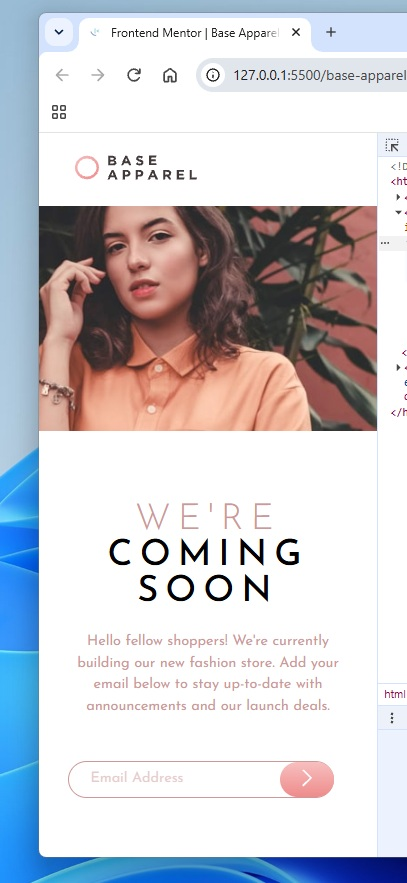
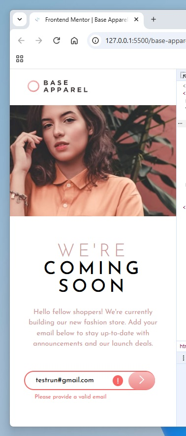
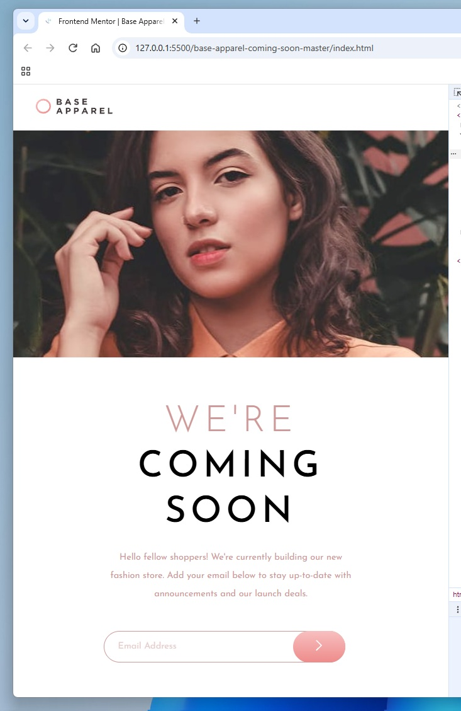
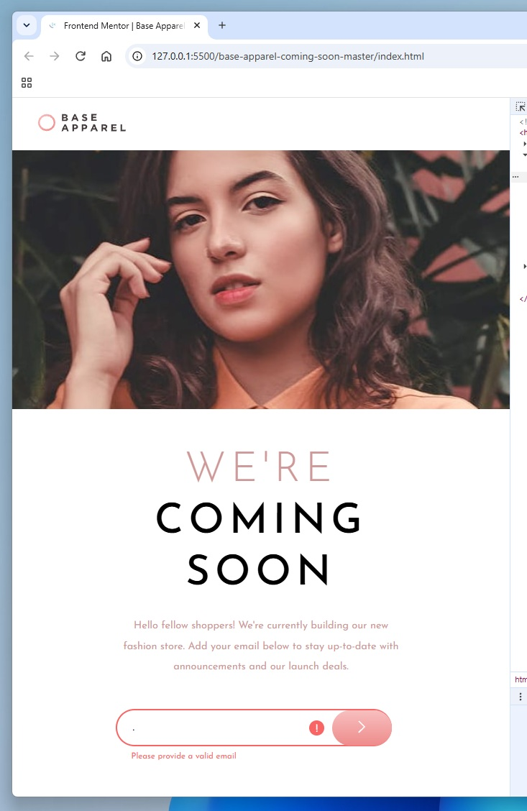
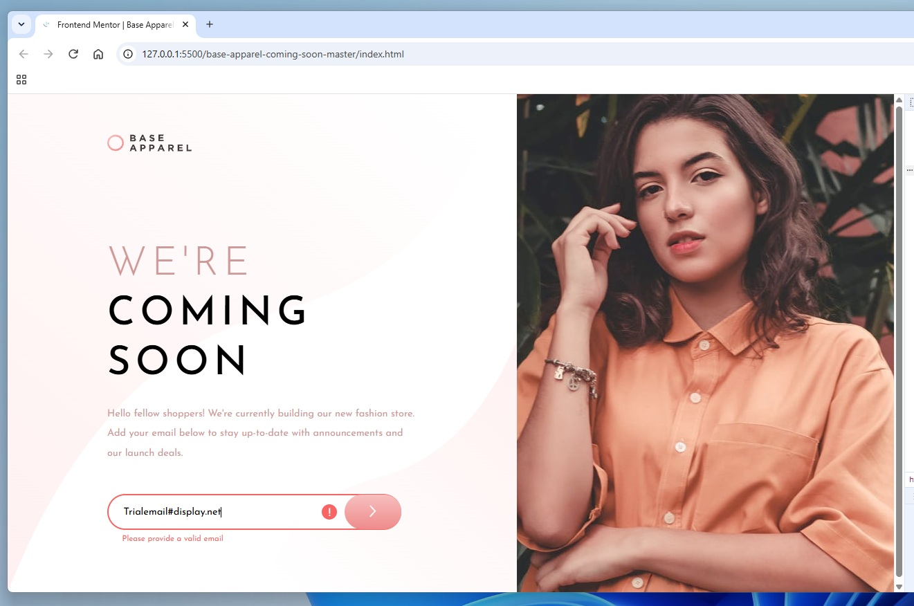

# Frontend Mentor - Base apparel coming soon page solution

This is a solution to the [Base apparel coming soon page challenge on Frontend Mentor](https://www.frontendmentor.io/base-apparel-coming-soon-page-5d46b47f8db8a7063f9331a0). Frontend Mentor challenges help you improve your coding skills by building realistic projects. 

## Table of contents

- [Overview](#overview)
  - [The challenge](#the-challenge)
  - [Screenshots](#screenshots)
  - [Links](#links)
- [My process](#my-process)
  - [Built with](#built-with)
  - [What I learned](#what-i-learned)
    - [Achievements](#achievements)
    - [Challenges](#challenges)
    - [Continued development](#continued-development)
  - [AI Collaboration](#ai-collaboration)

## Overview

### The challenge

Users should be able to:

- View the optimal layout depending on their device's screen size.
- See hover and focus states for all interactive elements on the page.
- Receive an error message when the form is submitted if the input field is empty or the email address is not formatted correctly.

### Screenshots

#### Mobile default

#### Mobile error

#### Tablet default

#### Tablet error

#### Desktop default

#### Desktop error

### Links

- Solution URL: [GitHub repo](https://github.com/Acemeistre/FEM_Base-apparel-coming-soon-page/)
- Live Site URL: [Live site](https://acemeistre.github.io/FEM_Base-apparel-coming-soon-page/)

## My process

### Built with

- Semantic HTML5 markup
- CSS custom properties
- Flexbox
- CSS Grid
- JavaScript

### What I learned

#### Achievements
- Built custom JavaScript email validation using `<form novalidate>`, regular expressions `/^[^\s@]+@[^\s@]+\.[^\s@]+$/`, and ARIA attributes `aria-invalid`, `aria-describedby`, and `aria-live="polite"` to give both visual and screen-reader feedback without relying on browser default tooltips.
- Implemented a mobile-first layout that scales smoothly through a single-column tablet view (using `aspect-ratio` to preserve hero image framing) into a two-column desktop CSS Grid layout (`grid-template-rows: auto 1fr` and `grid-row: 1 / 3`).
- Used the HTML `<picture>` and `<source>` elements to swap between hero-mobile.jpg and hero-desktop.jpg cleanly at the 768px breakpoint.
- Styled a custom pill-shaped form input with custom `:focus` styling, `.error` class toggles, and `:hover` / `:focus-visible` states on the submit button.

#### Challenges
- Getting used to how JavaScript toggles classes (`classList.add('error')`) and attributes (`setAttribute('aria-invalid', 'true')`) on submit, and understanding the difference between descendant selectors (`form.error .error-icon`) and compound selectors (`.error-msg.error`).
- Fixing default `<input>` styling—such as the two-tone black-and-pink border caused by writing `border-style` instead of the `border: 1px solid` shorthand, and removing the default black focus ring (`outline: none`)—while balancing input padding so the typed text doesn't overlap the error icon or submit button.
- Keeping the hero image from zooming or stretching excessively between 768px and 1279px, which led to discovering the CSS `aspect-ratio` property alongside `object-fit: cover` and `object-position`.
- Understanding how Grid line numbering (`grid-row: 1 / 3`) allows the hero image container to span both the `<header>` and `<main>` rows seamlessly.

#### Continued development/help
- Continuing to build confidence reading and writing regex patterns from scratch for different input types beyond basic email validation.
- Practicing accessible form patterns (`aria-live`, `aria-invalid`, `:focus-visible`) across future interactive components and testing them with actual keyboard navigation and screen readers.
- Getting faster at mapping out multi-row and multi-column Grid tracks before writing media queries, and knowing when to reach for modern properties like `aspect-ratio` and `clamp()`.

## AI Collaboration

- Tools used - Google AI and Claude.
- Used for - debugging and brainstorming solutions.
